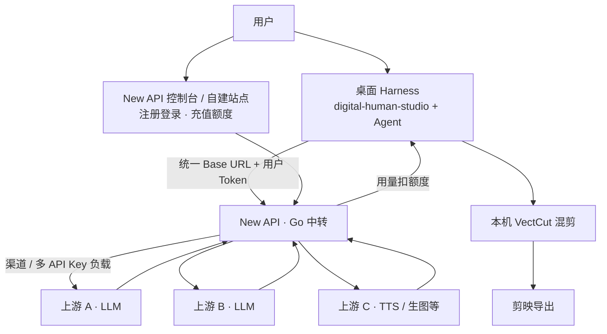

# harness-newapi-gateway

本地开发：数字人工作室 / DeepSeek Harness **多 API Key 聚合中转**，走 [New API](https://github.com/QuantumNous/new-api)（Go）。

剪辑（VectCut）仍在本机，**不**经 New API。PHP 数字人商城只作「登录 + 预冻/实扣」模式参考，**不在热路径**。

## 架构（目标流）



## 本目录做什么

| 路径 | 说明 |
|------|------|
| `docker-compose.yml` + `.env.example` | 本地起 New API + Postgres + Redis |
| `config/harness-newapi.stub.json` | 工作室日后合并的配置桩（默认关闭） |
| `ARCHITECTURE.md` | 分层与职责 |
| `SETUP.md` | 启动与接线步骤 |
| `NOTES.md` | 决策记忆（为何 New API、为何不用 PHP/Sub2API） |
| `CHANGELOG.md` | 变更记录 |

## 快速启动

```bash
cd "/Users/jiacong/Desktop/开发文件/数字人混剪工作台/harness-newapi-gateway"
cp .env.example .env   # 本地可先用默认；上线前改密码
./scripts/start-local.sh
# 浏览器打开 http://127.0.0.1:3000
```

停：`./scripts/stop-local.sh`

## 相关本机路径

- **工作台父目录**：`/Users/jiacong/Desktop/开发文件/数字人混剪工作台`
- 工作室插件：`/Users/jiacong/Desktop/开发文件/数字人混剪工作台/digital-human-studio`（兼容软链：`/Users/jiacong/digital-human-studio`）
- Harness 源码：`/Users/jiacong/Desktop/开发文件/数字人混剪工作台/deepseek-harness`
- 本网关：`/Users/jiacong/Desktop/开发文件/数字人混剪工作台/harness-newapi-gateway`
- 工作室运行配置：`/Users/jiacong/.dsh/digital-human-studio.json`（含 VectCut，勿整文件覆盖）
- 本地剪辑 skill：`/Users/jiacong/.dsh/skills/vectcut-local`
- VectCutAPI：`/Users/jiacong/VectCutAPI`（未迁入本工作台，保持独立）
- 开发文件根：`/Users/jiacong/Desktop/开发文件`

## 文档入口

1. [SETUP.md](./SETUP.md) — 怎么起、怎么拿 Token  
2. [ARCHITECTURE.md](./ARCHITECTURE.md) — 边界  
3. [NOTES.md](./NOTES.md) — 拍板记录  
